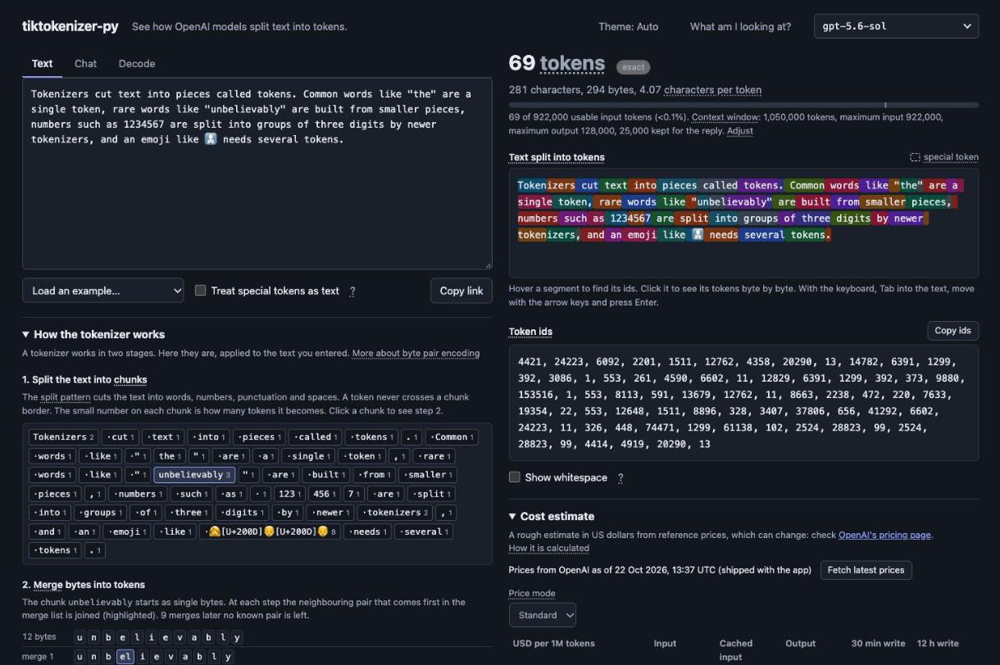

# tiktokenizer-py

tiktokenizer-py is a web page that shows how OpenAI models split text into tokens. Type or paste text and see the
token count, every token and its id, how the tokenizer arrived at them, and what the text would cost to send.

Tokenization runs on a Python server with [tiktoken](https://github.com/openai/tiktoken), OpenAI's own tokenizer
library, so plain-text counts are exactly what tiktoken returns. Everything runs locally in Docker.

**Local use only, by design.** The app has no login and no request limits, and anyone who can reach it can make
it fetch prices from OpenAI. Run it on your own machine; do not expose it to the internet.



> **AI usage disclosure**: This codebase was written with LLM-based tools. It is reviewed and tested, but bugs and odd patterns are possible. Review before relying on it in production.

## What you can do

- **Count tokens live** for any current or legacy OpenAI model, or for any tiktoken encoding.
- **See every token:** the text split into coloured segments, the token ids, and the bytes of each token.
- **Learn how tokenizing works:** the text cut into chunks, then a step-by-step replay of the merges inside one
  chunk.
- **Compare encodings:** the same text under every OpenAI encoding, from gpt2 to o200k_base.
- **Count a conversation:** build chat messages and see them wrapped in the model's chat framing.
- **Check the context window:** a meter shows how much of the model's input room the text uses.
- **Estimate the cost** per request, per day and per month from OpenAI's reference prices, which you can edit,
  including cache writes on newer models.
- **Decode token ids** back into text.
- **Share a link** that reopens the page with the same model, input and cost settings.

A plain-language glossary on the page explains every term. [GUIDE.md](GUIDE.md) walks through each feature in
detail.

## Quick start

You need Docker (Docker Desktop on macOS, Docker Engine on Linux) with Compose 2.24 or later, plus
[just](https://just.systems/) and [uv](https://docs.astral.sh/uv/).

```sh
git clone https://github.com/ailequal/tiktokenizer-py.git
cd tiktokenizer-py
just setup    # install the Python environment and download the tokenizer files
just up       # build the image and start the app
```

Open <http://localhost:8000>. Stop the app with `just down`.

The port is published on `127.0.0.1` only. If port 8000 is taken, run `APP_PORT=8010 just up` or set `APP_PORT`
in `.env`. To run without Docker, use `just dev` after `just setup`.

If the [SparkFabrik HTTP proxy](https://github.com/sparkfabrik/http-proxy) runs on your machine, the app also
answers on <http://tiktokenizer-py.spark.loc>. `just up` prints every address that works.

## Configuration

Copy `.env.example` to `.env` to change a setting. The containers and the `just dev`, `just run` and
`just docker-run` recipes read it.

| Variable             | Default   | Meaning                                                           |
| -------------------- | --------- | ----------------------------------------------------------------- |
| `APP_PORT`           | `8000`    | Port on localhost                                                 |
| `APP_MAX_TEXT_CHARS` | `200000`  | Longest accepted input, in characters (text or all chat messages) |
| `APP_MAX_BODY_BYTES` | `1000000` | Largest accepted request body, in bytes                           |
| `APP_DATA_DIR`       | see below | Where prices fetched from the page are saved                      |
| `UVICORN_LOG_LEVEL`  | `info`    | Server log level                                                  |

`APP_DATA_DIR` is `/app/data` in the image, where Compose mounts a named volume, and `.app-data/` on the host.
Without it, fetched prices last until the server restarts.

## API

The page uses a JSON API that you can call too. Interactive documentation is at <http://localhost:8000/docs>; the
app serves it itself, so it works offline.

```sh
curl -s http://localhost:8000/api/tokenize \
  -H 'content-type: application/json' \
  -d '{"model": "gpt-5", "text": "hello world"}'
```

| Endpoint                    | Returns                                                   |
| --------------------------- | --------------------------------------------------------- |
| `POST /api/tokenize`        | Tokens, count and segments for `text` or chat `messages`  |
| `POST /api/explain`         | The chunks of the split pattern and the tokens of each    |
| `POST /api/merges`          | Every byte pair merge that turns one chunk into tokens    |
| `POST /api/compare`         | Token counts for the same text under every encoding       |
| `POST /api/decode`          | Text and per-token bytes for a list of token ids          |
| `GET /api/models`           | The model catalogue with its groups and encodings         |
| `GET /api/encodings`        | Every encoding, including the derived chat variants       |
| `GET /api/encodings/{name}` | Vocabulary size, special tokens, split pattern and models |
| `GET /api/prices`           | Reference prices and context limits for every model       |
| `POST /api/prices/refresh`  | Fetch the prices again from OpenAI                        |
| `GET /healthz`              | `{"status": "ok"}` when the server is ready               |

[GUIDE.md](GUIDE.md#the-json-api) covers request options, limits and the error format.

## Accuracy

- **Plain text:** counts are exact. They use the encoding tiktoken reports for the model.
- **Chat for API models:** counts are marked as estimates, because OpenAI does not publish the chat framing.
  They match the API-verified numbers in OpenAI's
  [token counting guide](https://developers.openai.com/cookbook/examples/how_to_count_tokens_with_tiktoken).
- **Chat for gpt-oss:** counts are exact. They use the Harmony format that OpenAI documents.
- **Prices:** estimates from OpenAI's official pages. OpenAI's pricing page and your invoice are authoritative.

## Development

Run `just` to list every recipe. The main ones:

| Command                      | What it does                                                    |
| ---------------------------- | --------------------------------------------------------------- |
| `just dev`                   | Run the app on the host with auto-reload                        |
| `just up-dev`                | Run the dev container with `src/` mounted and auto-reload       |
| `just check`                 | Lint, type-check and test                                       |
| `just cov`                   | Run the tests with a coverage report; fails below 85%           |
| `just docker-test`           | Run the tests inside the dev image                              |
| `just docker-smoke`          | Test the production image offline, read-only and as non-root    |
| `just docker-build-multi`    | Build and run the image for `linux/amd64` and `linux/arm64`     |
| `just tokenize gpt-5 "text"` | Tokenize from the command line (add `--json` or `--plain`)      |
| `just models`                | Print the model and encoding catalogue                          |
| `just prices-update`         | Refresh the bundled prices from OpenAI's pages; review the diff |
| `just logs` / `just down`    | Follow the container logs / stop every container                |

The tokenizer files are downloaded during `docker build` and baked into the image, so the running app needs no
network access to tokenize. Behind a corporate proxy, pass `--build-arg HTTPS_PROXY=...` to the build. On the host
they are cached in `.tiktoken-cache/`.

### Project layout

```text
src/tiktokenizer_py/   Python package (import name tiktokenizer_py)
  main.py              app factory; settings.py reads the APP_* variables
  api.py, web.py       JSON API under /api; the HTML page and /healthz
  catalogue.py ...     tokenizer, chat, explain and price logic, one module each
  data/                price snapshot and hand-kept price overrides
  templates/, static/  page template, CSS and JS modules; vendored Alpine.js and Swagger UI
tests/                 pytest suite; test_<module>.py covers that module
scripts/               download the tokenizer files; refresh the price snapshot
docs/                  README screenshot
```

### Adding a model

The model list lives in `src/tiktokenizer_py/catalogue.py`. A model's encoding always comes from tiktoken, so a
model can be listed only once tiktoken knows it.

1. Run `just upgrade` and `just install` to move to the newest tiktoken.
2. Run `just check`. If `test_known_unmapped_models_still_raise` fails, tiktoken now maps that model.
3. Move the model from `KNOWN_UNMAPPED` to `CURRENT_MODELS` with its chat family, then run `just check` again.
4. Run `just prices-update` to add its price and context limits.

## Credits

tiktokenizer-py is an independent Python project inspired by [dqbd/tiktokenizer](https://github.com/dqbd/tiktokenizer)
(MIT, Tat Dat Duong). Tokenization is done by [openai/tiktoken](https://github.com/openai/tiktoken) (MIT, OpenAI).
The page uses [Alpine.js](https://alpinejs.dev/) (MIT, Caleb Porzio and contributors) and the API documentation uses
[Swagger UI](https://github.com/swagger-api/swagger-ui) (Apache-2.0, SmartBear Software). Both are vendored unchanged
with their licences in `src/tiktokenizer_py/static/vendor/`.

## License

MIT, see [LICENSE](LICENSE). Changes are listed in [CHANGELOG.md](CHANGELOG.md).
